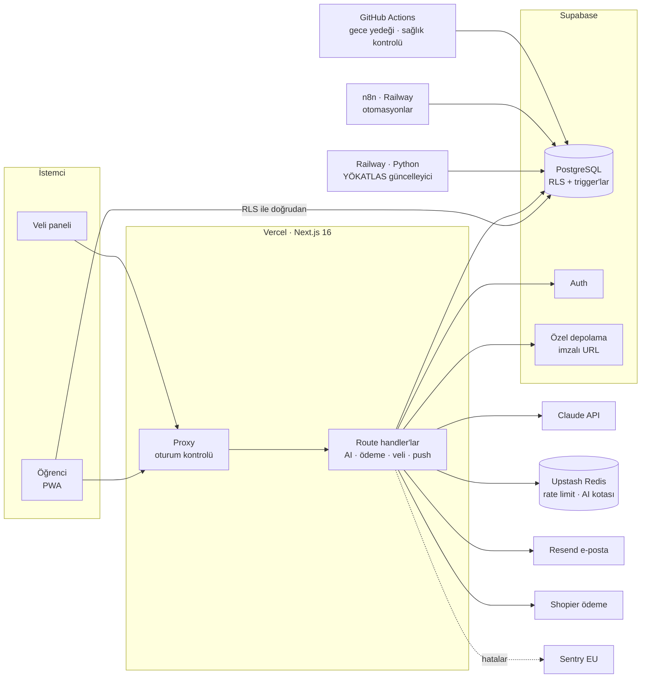

<h1 align="center">📚 Soru Takip</h1>
<p align="center"><b>YKS'ye hazırlanan öğrenciler ve velileri için çalışma takip, analiz ve AI koç platformu</b></p>

<p align="center">
  <a href="https://sorutakip.online"></a>
  
  
  
  
  
</p>

> **EN:** Soru Takip is a live study-tracking platform for Turkish university entrance exam (YKS) candidates. Students log daily questions by subject and topic. An AI coach turns that data into weekly analyses and plans, and parents follow progress from their own panel. Built and run solo, from product design to payments, security and compliance (KVKK).

🌐 **Canlı:** [sorutakip.online](https://sorutakip.online) · 🔐 [KVKK Aydınlatma Metni](https://sorutakip.online/kvkk)

> ℹ️ Bu depo projenin **Ekim 2026** tarihli vitrinidir: veritabanı şeması ve mimariyi gösteren seçilmiş dosyalar içerir. Ürün aktif olarak geliştiriliyor ve tam kaynak kod özel bir depoda tutuluyor. Aşağıdaki açıklamalar ürünün güncel halini anlatır.

---

## Neyi çözüyor?

YKS öğrencisi her gün yüzlerce soru çözüyor ama nerede iyi, nerede geride olduğunu göremiyor. Velisi de "bugün çalıştı mı?" sorusunun cevabını bilmiyor. Soru Takip bu iki sorunu birlikte çözüyor:

- **Öğrenci için:** 30 saniyede günlük kayıt, konu bazlı başarı oranı, net gelişimi grafikleri, AI koçtan "bugün ne çalışmalıyım?" önerisi
- **Veli için:** Ücretsiz veli paneli, haftalık özet, çalışma ısı haritası, öğrenciye motivasyon mesajı
- **Hedef için:** 40.000+ YÖKATLAS kaydıyla sıralamaya göre "yeterli / sınırda" üniversite önerileri

## Son güncellemeler

- **Ekim 2026:** Tanıtım ana sayfası; veli panelinde deneme sonuçları ve hedefe kalan net; konu takibi, aralıklı tekrar ve AI pratik soruları; AI maliyet takibi ve bütçe tavanı; veritabanının AB'ye (Frankfurt) taşınması; gece yedeği ve sabah sağlık kontrolü; güvenlik sıkılaştırmaları (AI istek kilidi, fail-closed kontroller, ödeme durumu doğrulaması)

## Özellikler

| Alan | Neler var |
|---|---|
| 📝 **Takip** | TYT/AYT ders ve konu bazlı D/Y/B kaydı, deneme takibi, haftalık hedef, çalışma takvimi, Pomodoro |
| 📊 **Analiz** | Haftalık ve 30 günlük net grafikleri, geçen haftayla karşılaştırma, paylaşılabilir PNG rapor kartı |
| 🤖 **AI Koç** | Konu analizi, deneme yorumu, haftalık çalışma planı, günlük öneri (Claude API) |
| 📕 **Hata Defteri** | Yanlış sorunun fotoğrafı, AI ile çözüm, ders/konu/zorluk tespiti ve güven skoru; FSRS ile aralıklı tekrar ("Bugün tekrar et" listesi) |
| 🧠 **Konu Takibi** | TYT/AYT konu listesi, kayıtlardan konu bazlı doğruluk oranı, en zayıf konular |
| ✏️ **Pratik Soru** | Yanlış yapılan konudan YKS formatında (5 şık) AI soruları; her soru ayrı bir model çağrısıyla bağımsız doğrulanıyor |
| 🎯 **Üniversite** | YÖKATLAS 2025 + 2026 verisi, başarı sırasına göre eşleşen programlar, hedef bölüme kalan net; herkese açık bölüm/program sayfaları ve puan hesaplayıcı |
| 👨‍👩‍👦 **Veli Paneli** | E-posta daveti, haftalık rapor, ısı haritası, deneme sonuçları, sınava kalan gün ve hedefe kalan net, mesaj gönderme; 3-5 gün kayıt girilmezse veliye nazik hatırlatma e-postası |
| 🔥 **Motivasyon** | Duolingo tarzı seri (streak), kilometre taşları, push bildirimleri, paylaşılabilir haftalık başarı kartı (story formatı), "arkadaşını getir" |
| 💎 **Premium** | 7 gün deneme, aylık ve "YKS'ye kadar" paketler, "velinden iste" ödeme linki |
| 📴 **Offline** | Telefona uygulama olarak yüklenebilen PWA; internet yokken kayıtlar kuyruğa alınıp bağlantı gelince gönderiliyor |

## Mimari



## Teknik öne çıkanlar

**Güvenlik**
- Her tabloda Row Level Security: öğrenci yalnızca kendi verisine erişir, kimlik `auth.uid()` üzerinden çözülür
- Sunucu tarafında kimlik: API'ler öğrenci kimliğini istek gövdesinden değil oturumdan alır (IDOR koruması)
- Veli oturumu HMAC imzalı, `httpOnly` çerezle sunucuda doğrulanıyor
- Upstash Redis ile IP bazlı rate limit ve öğrenci başına AI kotası; AI uç noktalarında öğrenci başına aynı anda tek istek (Redis kilidi), böylece eşzamanlı isteklerle kota aşılamıyor
- Yetki ve bütçe kontrolleri hata anında kapalı kalıyor (fail-closed): altyapı yanıt vermezse erişim açılmıyor
- E-posta gönderen uçlarda öğrenci başına günlük sınır ve sabit konu satırı (oltalama için kötüye kullanılamıyor)
- Güvenlik başlıkları (CSP `frame-ancestors`, HSTS, `nosniff`), hata defteri fotoğrafları özel depoda ve kısa süreli imzalı URL'lerle sunuluyor

**Yapay zekâ**
- Sayısal hesaplar (net, başarı oranı, seri, sıralama eşleştirme) kodda yapılıyor. LLM sadece yorum ve plan üretiyor.
- Göreve göre model seçimi: görsel soru çözümü için Sonnet, kısa günlük öneri için Haiku
- Kotayla maliyet kontrolü: ücretsiz planda haftalık, premium'da günlük adil kullanım sınırı
- Her AI çağrısı token ve maliyetiyle kaydediliyor; öğrenci başına aylık bütçe tavanı var, tavana yaklaşınca daha ucuz modele geçiliyor

**Ödeme ve iş modeli**
- Shopier entegrasyonu: imza doğrulamalı bildirim, sipariş Shopier API'sinden yeniden okunuyor ve yalnızca açıkça "ödendi" durumundakiler işleniyor; her ödeme isteği yalnızca bir kez kredilendirilir
- Fiyat ve süre her zaman sunucuda hesaplanıyor. "YKS'ye kadar" paketin süresi ödeme anında sınav tarihine göre belirleniyor.
- Ücretsiz plan limitleri veritabanı trigger'larıyla uygulanıyor, istemciden aşılamıyor
- Mesafeli satış sözleşmesi, ön bilgilendirme ve cayma onayı akışın içinde

**Veri**
- Railway üzerindeki Python servisi YÖKATLAS'tan 20.000+ programı çekip yıllık olarak güncelliyor
- 308 TYT/AYT konusu, sınav tarihleri cron + AI web araması ile otomatik güncelleniyor

**Altyapı ve operasyon**
- Veritabanı (Supabase) ve sunucu fonksiyonları (Vercel) Frankfurt'ta, AB bölgesinde; Tokyo'dan Frankfurt'a taşıma GitHub Actions iş akışıyla yapıldı
- Her gece şifreli (AES-256) `pg_dump` yedeği, bozuk/boş yedek kontrolüyle (GitHub Actions)
- Her sabah otomatik sağlık kontrolü (yayın durumu ve sayfalar) ve salt okunur bir AI ajanının hazırladığı durum raporu: hatalar, veritabanı uyarıları, kullanım sayıları, yedek sonucu
- Hatırlatma ve haftalık rapor e-postaları Vercel cron ile; aynı e-postanın iki kez gitmesi veritabanı kaydıyla engelleniyor

**Uyumluluk (KVKK)**
- 18 yaş altı kayıtta veli beyanı ve veliye otomatik bilgilendirme e-postası
- Açık rıza modali, aydınlatma metni, veri işleme envanteri
- Tek tıkla hesap silme: tüm kayıtlar ve fotoğraflar siliniyor

## Teknolojiler

`Next.js 16` `React 19` `TypeScript` `Tailwind CSS v4` `Supabase (PostgreSQL, Auth, Storage)` `Claude API` `Upstash Redis` `Resend` `Web Push` `Recharts` `Sentry` `Vercel` `Railway` `n8n` `Python` `Shopier` `GitHub Actions`

## Bu depodaki dosyalar

```
app/
├── api/bugun-ne-calisayim/route.ts   # AI günlük öneri: veriyi sunucuda özetler, kotadan düşer, Claude'a sorar
├── lib/
│   ├── sunucu.ts                     # Oturumdan öğrenci çözümleme, HMAC imzalı veli oturumu
│   ├── aiKota.ts                     # Upstash ile plan bazlı AI kullanım kotası
│   ├── plan.ts                       # Plan limitleri ve fiyatlandırma sabitleri
│   └── offlineQueue.ts               # IndexedDB tabanlı offline kayıt kuyruğu
└── components/SyncManager.tsx        # Bağlantı gelince kuyruğu senkronize eder
proxy.ts                              # Korunan rotalar (Next.js 16 proxy)
supabase/schema.sql                   # Şema, RLS politikaları, premium trigger'ları
.env.example                          # Gerekli ortam değişkenleri (değerler boş)
```

---

<p align="center">
  Geliştiren: <a href="https://github.com/ayberkfurkan1212">Ayberk Furkan Kaya</a> · <a href="https://www.linkedin.com/in/ayberkfurkankaya">LinkedIn</a><br/>
  <sub>Tam kaynak kod özeldir. Ürünü canlı olarak <a href="https://sorutakip.online">sorutakip.online</a> adresinde görebilirsiniz.</sub>
</p>
